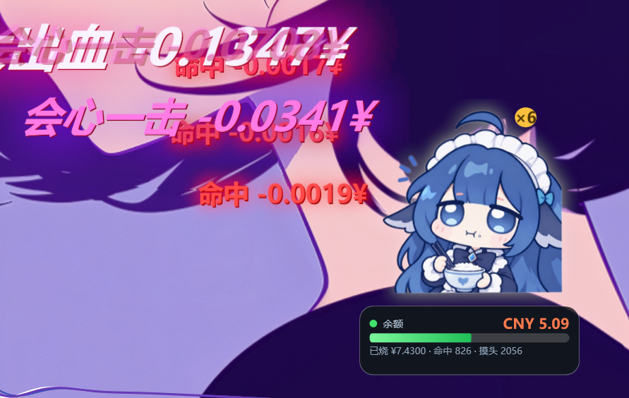

# 鲸娘桌宠 · DSH 花费可视化

你在 DeepSeek Harness（DSH）里每用一次 DeepSeek 模型，桌面上就落一个 `-0.0117¥` 的伤害数字；旁边一只鲸娘跟着扒饭，余额见底会发慌。

**适用范围（先说清楚）**：Windows 10/11 + Node.js 18 以上 + DeepSeek Harness。只验证过 DeepSeek 官方余额接口和 DSH 的会话统计。Codex / Claude Code 那条路没验证过，别指望。



> 上图是实机截图：一段对话里落下的三档数字（会心一击 / 大出血 / 命中）、右上角的连击 `×6`、右下角鲸娘和余额卡。

## 它会做什么

- **伤害数字**：一次调用落一个数字，金额决定档位 —— `命中`（≤¥0.02，34px 红）/ `会心一击`（≤¥0.08，54px 粉）/ `大出血`（>¥0.08，68px 白字洋红描边），抖动 120 / 240 / 420 ms。
- **连击**：5 秒内再来一发就叠 `×N`，从 2 开始显示。
- **鲸娘挂件**：命中时扒饭（两口一轮，停手 2.2 秒打个嗝）；余额掉到黄线流汗、红线发抖；摸头会点头并计数。
- **余额卡**：每 30 秒取一次 DeepSeek 余额，血条按 `capCny`（默认 ¥10）填满。
- **鼠标穿透**：默认不挡下面的窗口；托盘和右键菜单照常能点。
- **单实例**：重复双击不会开第二个；宿主崩了会被启动器重新拉起来。

## 立绘状态

余额状态（常态 / 黄 / 红）：


吃饭三帧（每发命中咬一口，停手 2.2 秒收尾）：


## 钱是怎么算出来的

1. `tools/dsh-usage.mjs` 盯着 `%USERPROFILE%\.dsh\storages\session_projcache\sessions\session-*.json`。
2. 每次读 `tokenUsage.totals` 里的四个数（未命中缓存输入 / 输出 / 缓存命中 / 缓存写入），跟上一轮比，只取**增量**。
3. 按 `core/prices.json` 的模型单价折成人民币 → `costCny`。
4. 通过本机总线 `127.0.0.1:17777` 发一条 `{t:'inject', kind:'hit', costCny, ...}`，宿主和插件收到后画数字、放动画。

单价表（每 100 万 token，单位见 config 里的 `currency`）：

| 模型 | 输入（未命中缓存） | 输入（命中缓存） | 输出 |
| --- | --- | --- | --- |
| deepseek-flash / deepseek-chat | ¥2.0 | ¥0.2 | ¥3.0 |
| deepseek-v4-pro | ¥2.0 | ¥0.2 | ¥3.0 |
| deepseek-reasoner | ¥4.0 | ¥0.5 | ¥12.0 |

单价是手抄的，DeepSeek 调价了自己改 `core/prices.json`；`tools/calibrate.mjs` 可以对着真实账单校准。

余额有两种来源，由 `balance.mode` 决定：

- `api`（默认）：每 30 秒请求 `https://api.deepseek.com/user/balance`，用真实余额。
- `ledger`：本地从 `startCny` 起自己扣，不联网。

`balance.api.apiKey` 留空时，会依次尝试环境变量 `DEEPSEEK_API_KEY` 和 `~/.codex/config.toml` 里的 key。

## 快速开始

1. 装 Node.js 18 以上；不想装可以把 `node.exe` 放进 `runtime\` 目录（程序会优先用它）。
2. 把压缩包**解压到硬盘任意目录**，别在压缩包里直接双击。
3. 双击 `dafeiyu.exe`。不想看到黑框就用 `pet-silent.vbs`。
4. 右键鲸娘 → **填写 DeepSeek API** → 粘上 key。key 只留在本机（内存 + `core/config.json`）。
5. 想马上看效果：右键 → **打一场演示（假数据）**。
6. 退出：托盘菜单 → **退出桌宠**，或运行 `stop.cmd`。

## 运行后会生成哪些文件

| 路径 | 内容 |
| --- | --- |
| `logs\` | 运行日志。**里面有本机会话路径和金额明细，发截图前先看一眼** |
| `core\state.json` | 余额、累计花费等滚动状态 |
| `plugins\dsh-whale-widget\position.json` | 挂件位置和缩放 |
| `plugins\dsh-whale-widget\state.json` | 摸头次数 |

这些都是本机状态，删掉会重置，不影响程序运行。

## 菜单

**右键鲸娘**：挂件大小（80% / 100% / 125% / 150%，当前档打勾）· 重置余额 · 填写 DeepSeek API · 打一场演示（假数据）· 预览呛到 · 余额状态预览（绿·正常 / 黄·余额偏低 / 红·余额危险 / 按真实余额）· 伤害数字 开/关 · 切换置顶 · 退出浮层

**托盘图标右键**：挂件大小 · 暴击数字（关/小/中/大）· 伤害数字（开/关）· 余额条（显示/隐藏）· 窗口置顶 · 开机自启 · 性能模式（流畅/省电）· 维护 · 退出桌宠

## 配置

改 `core/config.json`，重启生效。

| 键 | 默认 | 说明 |
| --- | --- | --- |
| `bus.port` | `17777` | 本机总线端口，被占了就换一个（插件也读这里） |
| `balance.mode` | `api` | `api` 走官方接口，`ledger` 本地记账 |
| `balance.capCny` | `10` | 血条满格金额，余额除以它 |
| `balance.api.apiKey` | `""` | DeepSeek key，右键菜单填，不要提交到仓库 |
| `balance.api.pollMs` | `30000` | 余额轮询间隔 |
| `balance.startCny` | `78.92` | ledger 模式的起始余额 |
| `watch.pollMs` | `400` | 会话文件轮询间隔 |
| `display.decimals` | `4` | 数字保留几位小数 |
| `combo.windowMs` | `5000` | 连击窗口 |
| `fx.screenShake` | `true` | 大额时窗口抖一下 |
| `host.tickMs` | `40` | 宿主刷新 tick |
| `host.clickThrough` | `true` | 鼠标穿透，不挡下层窗口 |

## 目录

```
dafeiyu.exe     启动器（C#，双击就开，负责拉起宿主、看门、托盘）
host\           WPF 宿主（PowerShell），按总线事件开窗口、跑动画
core\           总线服务、价格表、配置
plugins\        三个插件：伤害数字 / 鲸娘 / 气泡
tools\          统计、演示、校准、体检
src\            启动器与转发器源码
images\         立绘与图标
docs\           README 用的图
```

## 命令

| 命令 | 作用 |
| --- | --- |
| `dafeiyu.exe` | 启动（已有实例则直接退出） |
| `stop.cmd` | 全部停掉 |
| `demo.cmd` | 打一场演示，不产生真实花费 |
| `preview.cmd` | 离屏渲染几张预览图到 `preview\`（需要图形环境，远程桌面里可能出不来） |
| `build-exe.cmd` | 重新编译启动器（需要 VS 或 csc.exe） |
| `node tools\audit.mjs` | 体检：端口、进程、文件、配置 |
| `node tools\calibrate.mjs` | 用真实账单校准单价 |

## 常见问题

**数字不出来**

1. 确认 Node 可用：`node -v` 能出版本，或 `runtime\node.exe` 存在。
2. 看 `logs\dsh-usage.log`：接入成功会有一行「已接入」。
3. 确认 `%USERPROFILE%\.dsh\storages\session_projcache\sessions\` 下有 `session-*.json`，且 DSH 正在跑。
4. 端口被占：`core.log` 里会有监听失败，改 `bus.port`。

**余额一直 0 / 不动**

右键填 key，然后看 `logs\core.log` 里的请求结果；公司网络拦 `api.deepseek.com` 的话改成 `ledger` 模式。

**立绘没了**

`images\*.png` 缺失会回退到矢量版 `images\mascot.xaml`；连矢量版都没了就是空白。

**点不到鲸娘**

鼠标穿透默认开着，用托盘图标操作（托盘不受穿透影响）最快。

**杀不干净**

先 `stop.cmd`；还残留就结束 `dafeiyu.exe` 和跑 `core\server.mjs` 的那个 `node.exe`。

**Defender 报毒**

启动器是自签名（不是可信 CA 签的），第一次可能被拦；放行或加排除目录。

**挂件位置偏了**

`position.json` 里存的是逻辑像素，换显示器或改缩放后可能要重新拖。

## 已知限制

- 只验证过 DeepSeek + DSH。`core/prices.json` 里 GPT / Claude 的单价是手抄估算。
- `core/server.mjs` 里还留着读 `~/.codex/sessions/rollout-*.jsonl`、`~/.claude/projects/*.jsonl` 的实验分支（`watch.codexSessions`、`watch.claudeProjects` 默认 `true`）。这块没验证过，可能算错，建议都改成 `false`。
- 金额是估算：缓存读写、阶梯价、四舍五入都会让它跟账单差一点。
- 余额是 30 秒一次的轮询，不是实时。
- Linux / macOS 不支持。
- 多显示器、不同缩放比例的场景下，窗口位置可能需要手动拖一次。
